# Feature Packages for the Developer

The [wish list](../DEVELOPER_WISHLIST.md) has one item per gap. Many items
are parts of the same system, so we group them into **packages**. Each
package is one file. It collects what we need (with evidence), what the
game has today, how it fits the existing options, where it overlaps with
other packages, and what the endurance mode will need.

The wish list stays the short list for the developer. The package files
are where we keep collecting evidence and ideas.

Checked against game version 0.99.6 (beta).

## Pictures

Eight diagrams explain the idea with DTM and F1 examples. They are in
[img/](img/) and together on one page, [explainer.html](explainer.html).
Edit and rerun `python -I tools/package_diagrams.py` to change them.

| Picture | Shows |
|---|---|
| [The idea in one picture](img/big-picture.svg) | Three game modes, five shared blocks, today's pack files |
| [How it fits today's options](img/option-to-block.svg) | A regulation option that names a block |
| [Qualifying as stages](img/qualifying-stages.svg) | DTM 2012 Q1 to Q4, plus five other formats from the same stages |
| [Race rules as rows](img/race-rules.svg) | DTM 2013: two stops, pits closed for laps 1-3 and 38-40, the option tyre |
| [One lookup for every rule](img/scopes.svg) | DRS per session, stops per race, weight per make |
| [The entry as the unit](img/entry-model.svg) | A 1991 entry and an endurance crew, and who reads them |
| [One feature, every mode](img/modes.svg) | What formula, oval and endurance have today |
| [Ten delivery bundles](img/bundles.svg) | Quick wins, the core, and what builds on it |

## The packages

| Package | Wish-list items | Status |
|---|---|---|
| [Weekend format and qualifying](weekend-format.md) | A1, A2, A3, A5, A6 | Drafted, DTM evidence checked |
| [Tyres and pit stops](tyres-and-stops.md) | B5, B7, B10, B12, D6 (repair), D8, D9 | Drafted, DTM evidence checked |
| [Points and championships](points-and-championships.md) | B3, B4, B8, B9, C7 (points) | Outline |
| [Balance and homologation](balance-and-homologation.md) | B1, B2, C4, D7 | Outline |
| [Entries, drivers and crews](entries-and-crews.md) | C1, C2, C3, C5, C6, C8, C9 | Outline |
| [Car model](car-model.md) | D1, D2, D3, D5 | Outline |
| [Race control and overtaking aids](race-control.md) | B6, B11, B13, A3 (starts, red flags) | Outline |
| [Calendar, weather and the wider world](calendar-and-world.md) | A4, C7, D4, E6, E7 | Outline |
| [Modding format and tools](modding-format.md) | E1, E2, E3, E5, E13 | Outline |
| [Presentation and sound](presentation.md) | E4, E8 to E12, E14, E15, E18 | Outline |

Every wish-list item has one home package. Items that touch other
packages are listed under "Overlaps" in each file.

## Three game modes

The game has a **formula** mode and an **oval** mode (`series.json`
`game_mode`). An **endurance** mode is coming. Today many features exist
in one mode only:

| Feature | Formula | Oval | Our request |
|---|---|---|---|
| Rolling start | No (standing only) | `oval_start_procedure` `double_file_pace_lap` | A3: also for formula packs |
| More than 3 cars per team | `formula_team_entry_cap` up to `three` | `oval_team_entry_cap` up to `entries_6` | C1: same range for formula packs |
| Grid size as a regulation | `QUALI_GRID_LIMIT` constant | `oval_grid_limit` (40, 43, 45) | A6: a stage setting |
| Points for part of a race | No | `oval_stage_racing` with `stage_points` | B3: points per session |
| Playoffs | No | `oval_championship_format` `chase` | Points package |
| Red flags | `formula_red_flags` (stop, restart, up to 2) | Not seen | A3: aggregate result |
| Pole and fastest-lap point | `pole_point`, `fastest_lap_point` | `oval_pole_point`, `oval_fastest_lap_point` | B8: tables |
| Refuelling, tank size | `formula_refueling`, `formula_fuel_tank` | `oval_refueling`, `oval_fuel_tank` | Already shared in spirit |

**Idea:** build each feature once and let a pack turn it on in any mode.
Endurance then gets rolling starts, big entries, stage-like points and
playoffs for free, and the formula packs get the oval features.

## One way to build it all

This fits the way regulations already work: a category, a list of options,
voting (`change_control`) and `scripted_changes`.

1. **Options carry payloads, as today.** `points_system` options already
   carry a `points` array, `car_profile` options carry multipliers,
   `weekend_tyre_allocation` options carry set counts. New features add
   fields to options in the same way. Nothing new to learn for modders.
2. **Big structures live in named blocks.** A stage list, a rule list or a
   points scheme is a block in `config.json` (like `oval_stage_racing`
   today) or in a new `rulesets.json`. The option points to it by id:
   `{"key": "dtm_2013", "qualifying": "dtm_2013_q4"}`. Voting still
   switches options; the blocks never vote.
3. **Today's options become presets.** `knockout`, `session_60`,
   `modern_top10`, `strict` are rewritten as blocks that give exactly
   today's behaviour. Packs without new fields don't change.
4. **One scope system for every rule.** Any value can be overridden by
   scope, checked from the most specific to the least:
   `entry > class > track > race of the weekend > session > season`.
   One lookup, `rule(key, context)`, serves every feature. This alone
   covers DRS in the race only (B6), stops per race (B5), Q4 size per track
   (A6), ballast per make (B2) and BoP per class (endurance).
5. **The entry is the unit.** An entry has a car, a number, a code, one to
   three drivers and **tags** (`class`, `guest`, `privateer`, `rookie`,
   `customer`). Points, qualifying groups, BoP and junior eligibility all
   read the same tags.
6. **The race writes events, rules read them.** Stops, laps on each tyre,
   safety-car periods and results are logged as events. A rule row checks
   the events after the race and gives the penalty. The AI planner checks
   the same rows before the race. A new rule is a new row type, not new
   code in many places.
7. **Dated changes.** `scripted_changes` gets an optional `effective_week`
   and a filter (`engine`, `team`, `class`), so mid-season BoP and
   homologation steps use the system that exists.
8. **Validation and overlay packs** ([Modding format](modding-format.md))
   make all of this cheaper to use: a pack ships only the blocks it
   changes, and the game reports bad ids at load time.

## Overlap map

These shared blocks show up in more than one package. Building the block
once serves all of them.

| Shared block | Packages that need it | Wish-list items |
|---|---|---|
| Weekend as a list of sessions and races | Weekend format, Points, Tyres, Calendar | A1, A3, A6, B3, B5, C7 |
| Scopes (per session, race, track, class, entry) | All | A6, B2, B5, B6, B12, endurance BoP |
| Entry with tags | Entries, Points, Balance, Weekend format, Presentation | B4, B9, C2, C3, C4, C6, C8, E4, E15 |
| Rule rows checked after the race and read by the AI | Tyres, Weekend format, Race control, Points | B5, B6, B8, B10, B11, B12 |
| Pit stop as a list of services | Tyres, Entries (driver change), Car model (repair) | B5, B10, C8, D6 |
| Points tables per session, scoring conditions | Points, Weekend format, Calendar | A1, A2, B3, B8, B9, C7 |
| Dated changes (`scripted_changes` with week and filter) | Balance, Calendar, Car model | B1, B2, C4, D7, E7 |
| Real dates for schedule weeks | Calendar, Balance, Car model (weather) | A4, B2, D4, E7 |
| Supplier contracts (engine, tyre, customer chassis) | Balance, Tyres, Presentation | C4, D9, E8, E12 |
| Pack-defined ids with labels and colours | Tyres, Car model, Presentation | D1, D8, E4 |

**Items that say the same thing twice:**

- **B5 and B12:** B5 is the urgent subset (stop count, windows, first and
  last laps closed). B12 is the full rule model. Build B12; B5 is its
  first rows.
- **B7 and B12:** set limits are rule rows. B7 keeps the screen fix (dry
  compounds from `tyremodel.json`).
- **B8 and A6:** qualifying points are a points table on a stage. The
  points package owns the tables.
- **B9 and C2:** a guest is an entry tag. C2 says when the entry races,
  B9 says it doesn't score.
- **B10 and B12:** what makes a stop count is a rule row; crew size and
  stop time stay in B10.
- **C4 and D7:** C4 says who owns the homologated design, D7 says when it
  may change. One homologation block, two settings.
- **D4 and A3:** a red flag for heavy rain is a race-control rule (A3) fed
  by weather (D4).
- **E4 and E15, C6:** per-entry car images, codes and portraits on screens
  are all "entry as the unit" shown in the UI.
- **A4, B2, D4 and E7:** all need real dates for schedule weeks.

## Endurance mode

What endurance racing needs, and which package supplies it:

| Need | Package |
|---|---|
| Crews of two to four drivers, drive-time rules, fatigue | [Entries](entries-and-crews.md) (C8) |
| Several classes in one race, classified and scored separately | [Entries](entries-and-crews.md) (tags), [Points](points-and-championships.md) |
| BoP per class and per event | [Balance](balance-and-homologation.md) |
| Race length in hours, night, warm-up | [Weekend format](weekend-format.md) |
| Qualifying per class, Hyperpole | [Weekend format](weekend-format.md) |
| Refuel then tyres, crew limits, double stints, driver change | [Tyres and pit stops](tyres-and-stops.md) |
| Slow zones, full-course yellow, several safety cars | [Race control](race-control.md) |
| Points by race length, double points for the big race | [Points](points-and-championships.md) |
| One-off entries for the big race | [Entries](entries-and-crews.md) (C2) |
| Weather and temperature through day and night | [Calendar and weather](calendar-and-world.md) |
| Reliability over 24 hours, repairs in the garage | [Car model](car-model.md) |

The DTM packs need most of these blocks too: crews are the only one we
don't. So every DTM request that is built as a shared block also prepares
the endurance mode.

## How to add evidence

Each package file ends with an **evidence log**. Add one row per fact:

| Item | Season | Need | Source | Status |
|---|---|---|---|---|
| B12 | F1 2025 | Monaco: two mandatory stops | FIA sporting regulations 2025 | To source |

Status is `Checked` (from a source we read), `To source` (from memory) or
`Unverified` (sources disagree). When a fact is checked, update the
wish-list item too.
